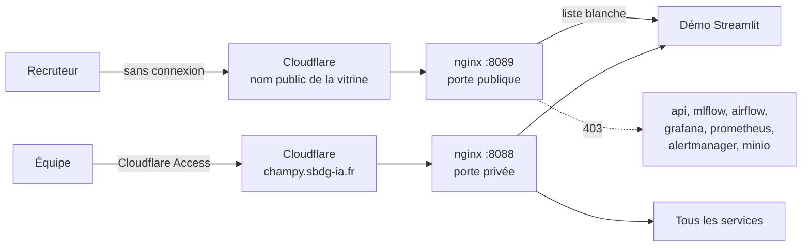

# ADR 0001 — Ouvrir une vitrine publique de la démo, sans exposer l'exploitation

- **Statut** : proposé (9 novembre 2026)
- **Auteur** : Dominique GEORGES

## Contexte

La plateforme est en ligne à `https://champy.sbdg-ia.fr`, entièrement derrière
Cloudflare Access (connexion obligatoire). Pour des candidatures, une démo
**ouverte à tous** est utile : un recruteur doit pouvoir tester la
reconnaissance d'un champignon sans compte.

Un audit de sécurité (lecture seule, 9 novembre 2026) a montré que, derrière
Cloudflare Access, **aucun service n'avait sa propre authentification** :
MLflow, Prometheus et Alertmanager répondaient sans mot de passe ; la page
« Plateforme » affichait les identifiants d'Airflow, de Grafana et de MinIO ;
la page de connexion publiait le compte admin de la démo ; une adresse de
webhook Discord était écrite en dur dans `docker-compose.yml`, dans un dépôt
public.

Ouvrir le nom de domaine existant aurait donc rendu publics tous les outils
d'administration, dont Airflow, qui peut exécuter du code sur les machines.

## Décision

Deux portes distinctes sur la même façade nginx :

1. **Porte publique (port 8089)** : un serveur nginx qui ne connaît que la démo
   Streamlit. Les routes d'exploitation répondent 403. Limite de débit par
   visiteur (adresse réelle lue dans `CF-Connecting-IP`), limite de
   connexions, envoi de fichier plafonné à 6 Mo.
2. **Porte privée (port 8088)** : inchangée, toujours derrière Cloudflare
   Access.
3. **Dans la démo** : toutes les pages appellent `auth.setup_page()` ; seules
   l'accueil, la prédiction et les perspectives sont ouvertes aux invités. La
   page « Plateforme » est réservée aux comptes identifiés et n'affiche plus
   aucun identifiant.
4. **Comptes** : le compte `user` (lecture seule) reste affiché pour montrer la
   gestion des rôles. Le compte `admin` n'est plus publié ; son hash n'est
   plus dans le dépôt mais dans le `.env` (`CHAMPY_ADMIN_PASSWORD_HASH`).
   Sans cette variable, le compte est désactivé.
5. **Secrets** : le webhook Discord est lu dans le `.env`. Aucun mot de passe
   par défaut faible dans `docker-compose.yml` : le démarrage est refusé si
   une variable obligatoire manque (`${VAR:?}`).
6. **Réseau local** : tous les ports sont liés à `127.0.0.1`, sauf les deux
   portes nginx.
7. **Streamlit** : pas de trace d'erreur affichée, envoi limité à 5 Mo, code
   monté en lecture seule, plus de rechargement automatique.

## Options écartées

- **Règle Cloudflare « Bypass » par chemin** : la démo occupe la racine du site
  et Streamlit sert ses ressources sous `/_stcore/` et `/static/`. Une liste de
  chemins ouverts serait fragile, et une erreur ouvrirait un outil
  d'administration.
- **Ouvrir tout le domaine** : rejeté, voir le contexte.

## Conséquences

- Les tests `tests/unit/test_vitrine_securite.py` verrouillent ces règles :
  pas de webhook en dur, pas de défaut faible, pas d'admin publié, chaque page
  sous contrôle d'accès, porte publique limitée à la démo.
- Le webhook Discord publié dans l'historique Git a été **supprimé côté
  Discord** et remplacé : l'ancienne adresse ne sert plus à rien. L'historique
  n'est donc pas réécrit, ce qui évite de modifier le dépôt de l'autre membre
  de l'équipe.
- Le mot de passe admin qui figurait en clair dans le dépôt ne fonctionne
  plus.

## Exigences non fonctionnelles

| Sujet | Traitement |
|---|---|
| RGPD | L'API enregistre chaque prédiction dans un SQLite (contenu exact à vérifier : image ou seulement le résultat). Les visiteurs publics passent par la démo : **documenté mais non traité** (durée de conservation à fixer, mention à ajouter sur la page de prédiction). |
| Surveillance | Prometheus et Grafana existants ; pas d'alerte dédiée à la vitrine (**non implémenté**). Cloudflare fournit les statistiques de trafic. |
| Disponibilité | Hébergée sur le NUC3, dont le disque système est en cours de remplacement (novembre 2026). Prévoir une solution de secours dans les candidatures : dépôt GitHub public et vidéo. |
| Régression | Tests ci-dessus, exécutés avec la suite unitaire. |

## Risques résiduels connus (documentés, non traités ici)

- Les conteneurs `demo` et `api` reçoivent tout le `.env` (`env_file`). La
  démo n'utilise plus les identifiants des services, mais elle les a toujours
  en mémoire.
- Les mots de passe déjà initialisés (Postgres d'Airflow, administrateur de
  Grafana) ne changent pas en modifiant le `.env` : il faut une rotation
  manuelle dans chaque service. Ces services ne sont plus joignables que par
  la porte privée.
- `docker_exporter` monte la socket Docker ; le registre (`docker-compose.registry.yml`)
  reste ouvert sur le réseau local.
- Conteneurs lancés en root (`Dockerfile.demo`, `Dockerfile.api`).
- La limite d'essais de connexion est stockée dans la session Streamlit : une
  nouvelle session la remet à zéro. La limite de débit nginx et le coût de
  bcrypt freinent les essais en série.

## Mise en service

1. Dans le `.env` (jamais dans Git) : `DISCORD_WEBHOOK_URL`, `AIRFLOW_DB_PASSWORD`,
   et si souhaité `CHAMPY_ADMIN_PASSWORD_HASH` (voir `.env.example`).
2. `docker compose up -d` (redémarre nginx, la démo et les services dont les
   ports changent).
3. Vérifier en local : `curl -I http://127.0.0.1:8089/` → 200 ;
   `curl -I http://127.0.0.1:8089/mlflow/` → 403.
4. Dans Cloudflare Zero Trust, sur le tunnel existant : ajouter un nom public
   (par exemple `demo-champy.sbdg-ia.fr`) vers `http://<adresse du NUC3>:8089`,
   **sans** application Access. Ne rien changer à `champy.sbdg-ia.fr`.
5. Recommandé : une règle de limitation de débit Cloudflare sur ce nom.
